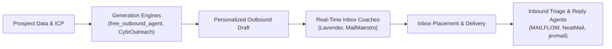

# ✉️ Awesome AI Email Copywriting 🚀

  <strong>Curated Directory of Production-Grade SaaS Platforms & Open-Source AI Email Writing Projects</strong> 
  <em>Supercharge cold outreach, inbox reply triage, real-time sales coaching, and hyper-personalized outbound sequences with modern Large Language Models (LLMs).</em>

  
  
  
  
  
  

---

## 📑 Table of Contents

- [🌐 Sector Overview & Market Dynamics](#-sector-overview--market-dynamics)
- [🏢 SaaS & Hosted Commercial Platforms](#-saas--hosted-commercial-platforms)
- [💻 Open-Source GitHub Projects](#-open-source-github-projects)
- [🛠️ Architectural Trade-Offs: Coaching vs. Generation vs. Triage](#-architectural-trade-offs-coaching-vs-generation-vs-triage)
- [🤝 How to Contribute](#-how-to-contribute)
- [💖 Support](#-support)
- [📊 Star History](#-star-history)
- [⚠️ Disclaimer](#-disclaimer)

---

## 🌐 Sector Overview & Market Dynamics

The global market for **AI email assistants, sales cadence automation, and generative copywriting** is estimated at approximately **$2.5B to $4.0B**, on track to eclipse **$15B+ by the early 2030s** at an estimated **15% to 22% CAGR**. 

Market competition exhibits **moderate-to-high fragmentation**:
- **At the platform layer**, massive horizontal enterprise suites (such as **HubSpot Breeze/AI**, **Google Workspace Gemini**, and **Microsoft 365 Copilot**) dominate general corporate email drafting and CRM connectivity.
- **At the vertical edge**, a vibrant ecosystem of specialized SaaS startups and open-source autonomous agents compete aggressively on **hyper-personalized icebreakers**, **real-time email deliverability scoring**, **prospect signal scraping (LinkedIn/GitHub/Dev.to)**, and **custom multi-step sequence engines (AIDA, PAS, BAB)**.

---

## 🏢 SaaS & Hosted Commercial Platforms

*Sorted in descending order of company scale, funding, and valuation.*

| Platform | Company Scale (Revenue / Valuation) | Starting Tier Pricing | Free Tier / Trial Limits | Key Specialization & Outbound Capabilities |
| :--- | :--- | :--- | :--- | :--- |
| **[HubSpot AI Email Writer](https://www.hubspot.com/)** | ~$13.5B Market Cap (~$3.13B ARR) | Free CRM tier; Starter from **$15/seat/mo** (annual) or $20/mo | **Free forever plan**: 2,000 email sends/month with HubSpot branding and basic AI content assistance | Native CRM-integrated generative email for marketing campaigns and sales engagement. |
| **[Jasper](https://www.jasper.ai/)** | ~$1.5B Valuation (~$131M raised, ~$100M+ ARR) | Pro tier from **$59/seat/mo** (annual) or $69/mo; Business custom | **7-day free trial** of Pro plan (credit card required upfront; full Pro feature access) | Enterprise marketing copy, brand voice governance, and multi-channel campaign generation. |
| **[Copy.ai](https://www.copy.ai/)** | ~$100M+ Valuation (~$14M raised, ~$30M–$35M ARR) | Chat tier from **$24/mo** (annual) or $29/mo (up to 5 seats); Agents from $249/mo | **Free trial/grant**: 200 one-time test bonus credits upon sign-up (no perpetual free generation tier) | AI-native GTM workflow automation, sales sequences, and multi-model chat workspace. |
| **[Regie.ai](https://www.regie.ai/)** | ~$65.6M Raised (~$15.5M ARR) | Pro tier from **$49/seat/mo**; Team from $150/mo; Enterprise AI SEP from $180/seat/mo | **Free plan**: 250 one-time credits with workspace access for Gmail/Outlook drafting | Prospect research, enterprise sales cadence orchestration, and cold sequence generation. |
| **[Lavender](https://www.lavender.ai/)** | ~$14.2M Raised (~$11.9M ARR) | Starter from **$29/user/mo**; Pro $49/mo; Teams $69/mo | **Free forever plan**: Limited to 5 email coachings/month; 7-day free trial on paid plans | Real-time inbox email coaching, email scoring, and reply-rate optimization inside Gmail/Outlook. |
| **[Warmer.ai](https://warmer.ai/)** | ~$10.4M Seed Valuation | Growth plan from **$79/mo** (750 credits/mo); Pro $149/mo; Scale $399/mo | **Free trial**: Small test credit allowance to generate sample lines (no credit card required upfront) | Automated lead list enrichment and personalized cold email intro/icebreaker generation. |
| **[Hypotenuse AI](https://www.hypotenuse.ai/)** | ~$150K Raised (YC) (~$2.8M–$3M ARR) | Basic/Starter tier from **$19/mo** (annual) or $29/mo; Growth $59/mo | **7-day free trial**: Access to test templates and content generation (no credit card required) | AI content generation for e-commerce, product descriptions, and marketing emails. |
| **[MailMaestro](https://www.maestrolabs.com/)** | ~$1.3M Raised (Seed) | Pro tier from **$12/seat/mo** (annual) or $15/mo; TeamsMaestro $17/seat/mo | **Free forever plan**: Capped at 3 AI requests/week with MailMaestro watermark | AI email drafting, thread summaries, and inbox triage for Outlook and Gmail (Flowrite successor). |
| **[Smartwriter.ai](https://www.smartwriter.ai/)** | Bootstrapped (~$300K ARR) | Basic plan from **$49/mo** (annual) or $59/mo (400 lead credits/mo); Popular $149/mo | **7-day free trial**: Full access to cold email and lead personalization tools (no credit card required) | Automated personalized intro lines using LinkedIn and web scraping data. |
| **[Lyne.ai](https://lyne.ai/)** | Bootstrapped (PAYG model) | Pay-as-you-go from **$0.25/credit** ($0/mo base); Cold Email Custom $120/mo (2,000 credits) | **Free sign-up / PAYG tier**: $0/mo base access where users pay only per verified generated line (~$0.25/line) | High-volume first-line icebreaker generation from prospect profile scraping. |

---

## 💻 Open-Source GitHub Projects

*Sorted in descending order of GitHub star count.*

### 1. **[Jema.ai (jasper-alternative-gpt)](https://github.com/yuvalsuede/jasper-alternative-gpt)**

- **Description**: Open-source Jasper alternative built with ChatGPT API and Next.js. Provides a template-driven engine where each task corresponds to an extensible prompt template.
- **Tech Stack**: Next.js, TailwindCSS, OpenAI API
- **License**: MIT
- **Best For**: Developers wanting a clean, extensible web interface for template-driven generative copy and email prompts.

### 2. **[Email-automation](https://github.com/PaulleDemon/Email-automation)**

- **Description**: Robust open-source cold email outreach and automated campaign delivery engine with personalized field replacement, sequence dispatching, and contact tracking.
- **Tech Stack**: Python, SMTP, HTML/CSS
- **License**: Per Repo
- **Best For**: Marketers and sales teams seeking full control over delivery infrastructure without per-contact SaaS pricing.

### 3. **[NeatMail](https://Lakshay1509/NeatMail)**

- **Description**: Self-hostable AI email assistant for Gmail and Outlook that tracks commitments and promises made across threads, automatically classifies incoming mail, and drafts context-aware replies in your writing voice.
- **Tech Stack**: TypeScript, Python, Gmail/Outlook OAuth APIs
- **License**: ELv2 (Source-available)
- **Best For**: Founders and executives needing automated reply drafting and commitment tracking without data leaking to third-party vendors.

### 4. **[project-genai-cold-email-generator](https://github.com/codebasics/project-genai-cold-email-generator)**

- **Description**: End-to-end generative AI cold email writer that extracts job requirements and company details directly from careers URLs, retrieves relevant software portfolio links via ChromaDB vector embeddings, and writes tailored pitch emails using Meta Llama 3.1.
- **Tech Stack**: Python, Streamlit, LangChain, ChromaDB, Groq / Llama 3.1
- **License**: Apache-2.0 / Per Repo
- **Best For**: B2B agencies and business development reps pitching software services tailored to exact job openings.

### 5. **[jevmail](https://github.com/fazlerocks/jevmail)**

- **Description**: Fast, privacy-first open-source AI email triage engine for Gmail. Automatically categorizes incoming correspondence into Needs Reply, Updates, Promos, Sales, and Spam using small, high-speed decision models via Vercel AI Gateway (~1,000 emails/minute for ~$0.03).
- **Tech Stack**: TypeScript, Vercel AI Gateway, Gmail API
- **License**: MIT
- **Best For**: Privacy-sensitive users seeking instant inbox classification and high-throughput spam/sales filtering.

### 6. **[cold-email-ai](https://github.com/bdcorps/cold-email-ai)**

- **Description**: AI-driven cold outreach generator that processes lead lists to output personalized outbound emails and subject lines using OpenAI models.
- **Tech Stack**: Python, OpenAI API
- **License**: Per Repo
- **Best For**: Growth hackers scripting batch cold email drafts from lead CSV files.

### 7. **[skim](https://github.com/nikserg/skim)**

- **Description**: Lightweight (~5 MB), native open-source AI email client for Windows with Bring-Your-Own-Key (BYOK) AI integrations for rapid summarizing, response formulation, and thread intelligence.
- **Tech Stack**: C++, Win32, Local/Cloud LLM APIs
- **License**: GPL-3.0
- **Best For**: Windows power users looking for a lightning-fast native email client with local or BYOK AI drafting.

### 8. **[groq-gmail-assistant](https://github.com/Drlordbasil/groq-gmail-assistant)**

- **Description**: Ultra-low-latency AI email assistant leveraging Groq's LPU inference engine, Llama models, and LangChain RAG pipelines to read threads, query knowledge bases, and compose highly accurate drafts.
- **Tech Stack**: Python, Groq API, LangChain, Gmail API
- **License**: MIT
- **Best For**: Developers seeking real-time email reply latency powered by specialized Groq hardware.

### 9. **[mailpilot](https://github.com/t33devv/mailpilot)**

- **Description**: Open-source AI email writer Chrome extension built directly into the Gmail web compose interface, offering one-click tone changes and automated response drafting.
- **Tech Stack**: JavaScript, Chrome Extensions API, OpenAI API
- **License**: MIT
- **Best For**: Users wanting a free, self-managed alternative to commercial in-browser email extensions.

### 10. **[AIneta](https://github.com/manejmix/AIneta)**

- **Description**: AI email response automation platform designed to intercept incoming customer queries, synthesize relevant context, and propose ready-to-send replies.
- **Tech Stack**: Python, FastAPI, LLM Connectors
- **License**: Per Repo
- **Best For**: Customer support and sales teams building automated inbound triage loops.

### 11. **[free_outbound_agent](https://github.com/Dumebii/free_outbound_agent)**

- **Description**: Autonomous AI outbound pipeline agent that finds prospective leads on GitHub, Dev.to, and Product Hunt, synthesizes profile data with Claude or GPT-4, and schedules multi-step follow-up sequences over SMTP.
- **Tech Stack**: Python, YAML config, SMTP / Zoho / Gmail
- **License**: Per Repo
- **Best For**: Developer tools and technical founders wanting an end-to-end automated cold pipeline without SaaS subscription fees.

### 12. **[denshees](https://github.com/Webeasetech/denshees)**

- **Description**: Full-featured open-source cold email outreach and sales engagement suite featuring automated multi-stage campaigns, lead pipeline CRM, BullMQ dispatch queuing, and AI-assisted copywriting.
- **Tech Stack**: Next.js, Hono, BullMQ, PostgreSQL, Redis, LLMs
- **License**: MIT
- **Best For**: Teams wanting a modern self-hosted web app replicating commercial cold email platforms like Instantly or Lemlist.

### 13. **[MAILFLOW](https://github.com/NeoNexAI/MAILFLOW-AI_MAILING)**

- **Description**: Privacy-conscious, self-hosted AI email assistant that connects to IMAP/OAuth2 inboxes, sorts messages into folders, and prepares context-aware reply drafts using local Ollama models or cloud APIs. Drafts are safely saved to IMAP Drafts.
- **Tech Stack**: Next.js, Python FastAPI, PostgreSQL, Redis, LiteLLM, Docker
- **License**: AGPL-3.0
- **Best For**: Privacy-sensitive organizations demanding complete data sovereignty and local LLM execution.

### 14. **[CybrOutreach](https://github.com/M4ST3R-C0NTR0L/CybrOutreach)**

- **Description**: CLI cold email generation tool built around classical direct-response copywriting frameworks (AIDA, PAS, BAB). Features batch CSV lead processing and multiple tone selectors.
- **Tech Stack**: Python (PyPI package), OpenRouter, OpenAI, Anthropic
- **License**: Per Repo
- **Best For**: Sales engineers and outbound specialists needing structured batch email generation from CSV lead dumps.

### 15. **[WriteWise](https://github.com/tymepas/WriteWise_Project)**

- **Description**: AI writing and email polishing assistant that scores text on a 1–10 quality scale, generates subject lines, and features automated client-side secret/credential redaction prior to LLM submission.
- **Tech Stack**: React, Python, OpenAI API
- **License**: Per Repo
- **Best For**: Developers wanting a reference architecture for secure text improvement with client-side privacy redaction.

---

## 🛠️ Architectural Trade-Offs: Coaching vs. Generation vs. Triage

Understanding tool boundaries prevents architectural mismatches when building an outbound sales stack:

1. **Real-Time Email Coaches** (e.g., Lavender): Act as an interactive copilot inside Gmail/Outlook. They score email clarity, subject line brevity, and reading grade level. They do *not* run automated headless batch mailings.
2. **Cold Email Generation Pipelines** (e.g., free_outbound_agent, CybrOutreach, denshees): Focus on ingesting prospect firmographics (LinkedIn, GitHub) and formulating first lines or multi-touch sequences based on copywriting frameworks (AIDA, PAS).
3. **Inbound Reply & Triage Assistants** (e.g., NeatMail, MAILFLOW, jevmail): Handle post-send interactions by classifying replies, summarizing threads, extracting promises, and queueing draft replies to prevent inbound churn.

---

## 🤝 How to Contribute

Contributions are welcome! Help expand this directory by submitting new production-tested tools or open-source repositories:

1. **Fork the Repository** on GitHub.
2. **Add / Update an Entry** in `README.md` maintaining alphabetical or star/valuation-sorted order.
3. **Include Key Metadata**:
   - Project Name & Official Repository / Website Link
   - Accurate Star Badge (`style=social&color=white`) linking to the stargazers page
   - 1–2 sentence description of architecture and distinctive capabilities
   - Tech stack, licensing, and primary target use case
4. **Submit a Pull Request** with a brief summary of the project.

---

## 💖 Support

If you find this curated directory helpful for your sales development reps, engineering pipelines, or marketing automation projects, please consider supporting the project:

- ⭐ **Star this repository** on GitHub to increase visibility for open-source AI tooling.
- 🍴 **Fork and share** with colleagues building AI cold outreach systems.
- ☕ **Sponsor the Maintainer**: Support ongoing curation, open-source development, and maintenance via the [GitHub Sponsors Dashboard](https://github.com/sponsors/ishandutta2007).

---

## 📊 Star History

---

## ⚠️ Disclaimer

- This repository is a community-curated educational and technical resource. Mention of commercial products or open-source projects does not constitute a formal commercial endorsement.
- All email outreach, automated prospecting, and AI message dispatching must strictly abide by jurisdictional spam and data privacy legislation, including **CAN-SPAM Act**, **GDPR**, **CASL**, and **CCPA**, with valid unsubscribe mechanisms and data processing consent.
- Self-hosted outbound agents shift deliverability obligations entirely to the operator: ensure domain warming, DKIM, SPF, DMARC, and MX records are properly authenticated before initiating high-volume sequences.

---

  Maintained by <a href="https://github.com/ishandutta2007">Ishan Dutta</a> and the global open-source AI community.

